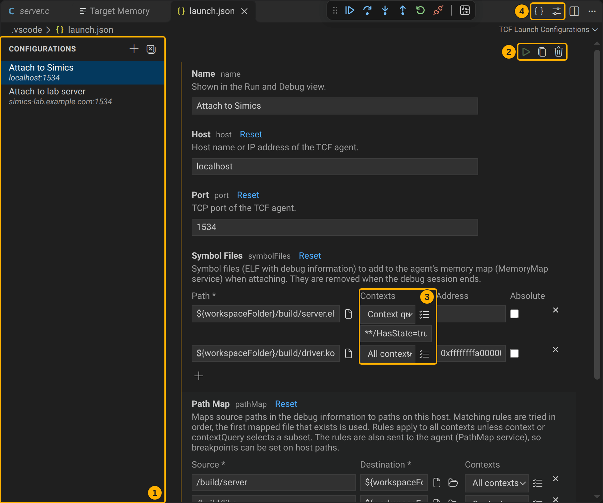

# Launch configurations

A debug session is started from a `simics-target-debug` configuration in
`.vscode/launch.json`:

```json
{
  "type": "simics-target-debug",
  "request": "attach",
  "name": "Attach to TCF agent",
  "host": "localhost",
  "port": 1534
}
```

Without a `launch.json`, selecting the "Simics Target Debug" debugger
attaches to `localhost:1534`.

## Attributes

| Attribute        | Default     | Description                                                                             |
| ---------------- | ----------- | --------------------------------------------------------------------------------------- |
| `host`           | `localhost` | Host name or IP address of the TCF agent.                                               |
| `port`           | `1534`      | TCP port of the TCF agent.                                                              |
| `connectTimeout` | `10000`     | Milliseconds to wait for the connection and the agent's `Locator.Hello`.                |
| `symbolFiles`    | `[]`        | Symbol files to load when attaching, see [Symbol files](/configuration/symbol-files).   |
| `pathMap`        | `[]`        | Source path mapping rules, see [Path mapping](/configuration/path-mapping).             |

Options that are the same for all debug sessions are not attributes of the
configuration. They are [settings](/configuration/settings).

## Launch configurations editor

**Simics Target Debug: Edit Launch Configurations** in the Command Palette
opens the `simics-target-debug` configurations of `.vscode/launch.json` in a
form, like the Settings editor: the configuration names on the left, the
attributes of the selected one on the right. With several workspace folders
it asks which folder to use, and it creates `launch.json` if there is none.

The buttons in the editor title switch between the form and the text of
`launch.json`, and **Open With...** on `launch.json` offers the form too.



1. The `simics-target-debug` configurations of `launch.json`, with the
   buttons **+** and **Delete All** above them.
2. **Start Debugging**, **Duplicate** and **Delete** for the selected
   configuration.
3. The **Contexts** column of a table, see
   [Symbol files and path map tables](#symbol-files-and-path-map-tables).
4. **Open launch.json as Text** and **Open Settings** in the editor title.

### Manage configurations

- The **+** button above the list adds a configuration, and **Delete All**
  deletes all `simics-target-debug` configurations, after asking. Other
  configurations in `launch.json` are kept.
- Each configuration has the buttons **Start Debugging**, **Duplicate** and
  **Delete**. New names are made unique.
- **Start Debugging** is disabled while a session to the same agent (host and
  port) runs, and while the name or a required value is empty.

### Edit attributes

- Each change is written to `launch.json` and saved at once. Only the changed
  value is rewritten, so comments, formatting and other debug types are kept.
- Text boxes write their value when they lose focus or Enter is pressed.
  **Reset** removes an attribute, so its default is used.
- Changes made in the text editor show up in the form at once. While
  `launch.json` has syntax errors the form is read-only.
- Of VS Code's own options only `internalConsoleOptions` (when to open the
  Debug Console) is shown, under **Advanced** at the end, with
  `connectTimeout`. Others, like `preLaunchTask`, are listed under **Other
  Attributes** when set, and can be edited in the text.
- The options that apply to all configurations are
  [settings](/configuration/settings). **Open Settings** in the editor title
  and the link at the end of the form open them.

### Symbol files and path map tables

`symbolFiles` and `pathMap` are edited in tables, with a row for each symbol
file or rule.

- The path of a symbol file and the destination of a path map rule have
  buttons to browse for it. A destination that does not exist on this host is
  marked.
- The **Contexts** column chooses what the row applies to: all contexts, a
  list of contexts separated by commas, or a context query, see
  [Selecting contexts](/configuration/contexts).
- **Pick Contexts...** next to it opens the
  [context picker](/configuration/contexts#the-context-picker) with the
  contexts of the target. It needs a running debug session to the agent of
  the configuration.

Attributes in the `launch` section of a `.code-workspace` file are not shown.
