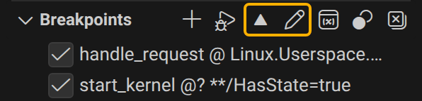

# Breakpoints

Breakpoints are kept in sync with the agent's breakpoint table: adding,
editing and removing breakpoints in VS Code changes them in the agent.
Breakpoints apply to all contexts the agent debugs, except function
breakpoints limited to selected contexts and instruction breakpoints, see
below.

## Kinds of breakpoints

| Breakpoint  | How to set it                                                                                                       |
| ----------- | ------------------------------------------------------------------------------------------------------------------- |
| Source line | Click left of a line in the editor.                                                                                 |
| Function    | **+** in the Breakpoints view. Enter the function name, or any expression the agent accepts.                        |
| Data        | **Add Data Breakpoint at Address** in the Breakpoints view. It breaks on read or write of the given address range.  |
| Instruction | Click left of an instruction in the [Disassembly view](/debugging/disassembly).                                     |

Breakpoints can have:

- A condition, which is evaluated by the agent.
- A hit count `N` or `>= N`. The breakpoint breaks from the N:th hit.
- A log message, which makes it a [logpoint](#logpoints).

## Verified breakpoints

A breakpoint is shown as verified when the agent reports at least one planted
instance. The line is moved to where the agent planted it, for example from a
line without code to the next line with code. Errors from the agent (unknown
file, line without code, invalid expression) are shown on the breakpoint.

## Logpoints

Logpoints are planted as breakpoints. When one is hit, the message is printed
to the Debug Console, with `{expression}` evaluated by the agent, and the
target is resumed. A step that is interrupted by a logpoint stops there.

## Function breakpoints

Function breakpoints stop at the first instruction of the function.

### Limit a function breakpoint to selected contexts

Use **Simics Target Debug: Add Function Breakpoint in Context...** from the
Command Palette, the Breakpoints toolbar, or a stack frame's context menu. It
opens the [context picker](/configuration/contexts#the-context-picker), with
the selected call-stack context as the suggested choice, and then asks for
the symbol.

{width=298}

The marked buttons in the title of the Breakpoints view are **Add Function
Breakpoint in Context...** (left) and **Edit Function Breakpoint
Contexts...** (right). The buttons show when the pointer is over the view.

The contexts are part of the name of the breakpoint, which the Breakpoints
view shows:

| Name                                        | Stops in                                    |
| ------------------------------------------- | ------------------------------------------- |
| `start_kernel`                              | All contexts.                               |
| `start_kernel @ board.cpu[0]`               | The context with this ID.                   |
| `start_kernel @ board.cpu[0], board.cpu[1]` | The listed contexts.                        |
| `start_kernel @? **/HasState=true`          | The contexts that match the context query.  |

The same syntax can be entered or edited using the built-in function
breakpoint **+** or **Edit Function Breakpoint...**.

- The ` @ ` suffix holds exact TCF context IDs, which are saved with the
  breakpoint; selecting another frame does not change its scope. Context IDs
  that contain commas cannot be used.
- The scope applies to the listed contexts (and, for a process context, its
  threads), not to other cores.
- The agent must be able to limit breakpoints to contexts (`ContextIds`) or
  to a context query (`ContextQuery`). If it cannot, the breakpoint gets an
  error. It is never set in all contexts instead.

### Change the contexts of a function breakpoint

Use **Simics Target Debug: Edit Function Breakpoint Contexts...** from the
Command Palette or the edit icon in the Breakpoints toolbar. VS Code does not
tell extensions which breakpoint is selected in the Breakpoints view, so the
command asks for the function breakpoint when there is more than one.

The context picker starts with the breakpoint's current contexts or query.
In its checklist, contexts that are not in the current session stay listed so
they are not dropped by accident. The breakpoint is replaced by one with the
new name and the same enabled state, condition, hit count, and log message,
so it moves to the end of the Breakpoints view.

### Add a function breakpoint from a symbol file

In the [Symbol Files](/configuration/symbol-files) view, right-click a
symbol file that has contexts or a context query and select **Add Function
Breakpoint...** to enter a symbol directly. The breakpoint uses the file's
contexts or query rather than the selected call-stack core. Context names are
resolved to exact TCF IDs; unavailable or ambiguous contexts produce an error
instead of creating a global breakpoint. Files for all contexts do not offer
this action.

## Instruction breakpoints

An address only has a meaning in one address space, so an instruction
breakpoint is limited to the process of the context shown in the Disassembly
view, and to the threads of that process. Without OS awareness the process of
a CPU context is the CPU itself. Agents that do not support limiting
breakpoints to contexts get the breakpoint in all contexts.

## Limitations

- There are no exception breakpoints.
- Breakpoints created by other TCF clients (or the Simics CLI) are not shown.

The breakpoint properties sent to the agent are listed in
[TCF services](/reference/tcf-services#breakpoints).
