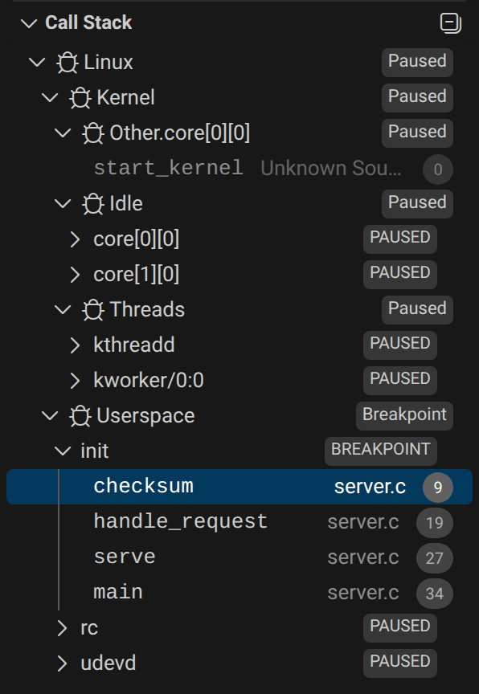

# Call stack

The Call Stack view shows the parts of the target that can run and be
stopped: processors and, with OS awareness, the processes and threads of the
operating system. They are shown as a tree that follows the structure of the
target. Parts with several threads, such as a board with several CPUs, an OS
awareness tracker or a multi-threaded process, are shown as groups that can
be expanded. Expand a thread to see its call stack.

## How the tree is built

To keep the tree short:

- Only parts with at least two threads get a group. A part with a single
  thread, such as most Linux processes, gets no group: its thread is listed
  in the group above.
- A thread listed in a group above is named by the parts in between, so
  thread `worker` of process `p3` is listed as `p3.worker`. A repeated name,
  such as process `init` with thread `init`, is shown once.
- If a group would hold only one thread next to other groups, that thread
  gets a row of its own, with its call stack right below it.

In a group, the threads are listed first, then the single threads with rows
of their own, then the other groups, each in the order of the target.

Groups come and go as processes and threads start and end. All groups share
the breakpoints and the Debug Console. Stopping or restarting any of them
stops or restarts the whole debug session.

## Example

Take this target with a Linux OS awareness tracker, with simplified names:

```text
Linux
├── Kernel
│   ├── Other ── core[0][0]
│   ├── Idle ──┬── core[0][0]
│   │          └── core[1][0]
│   └── Threads ──┬── kthreadd
│                 └── kworker/0:0
└── Userspace ──┬── init ── init
                ├── rc ── rc
                └── udevd ── udevd
```

The Call Stack view shows it like this:

```text
Linux                      group, in the row of the debug configuration
├── Kernel                 group
│   ├── Other.core[0][0]   single thread with a row of its own
│   ├── Idle               group
│   │   ├── core[0][0]     thread
│   │   └── core[1][0]     thread
│   └── Threads            group
│       ├── kthreadd       thread
│       └── kworker/0:0    thread
└── Userspace              group
    ├── init               thread
    ├── rc                 thread
    └── udevd              thread
```

`Other` and the processes in `Userspace` have a single thread each, so they
get no group. The thread of `Other` is next to the groups `Idle` and
`Threads`, so it gets a row of its own.

In VS Code it looks like this. The thread `init` has stopped at a breakpoint
and is expanded to show its call stack:

{width=298}

## Layout settings

Two settings change the layout. You find them under **Call Stack** in the
[settings](/configuration/settings). They are read when a debug session
starts.

- Turning off `simics-target-debug.callStack.hierarchy` shows no groups. All
  threads are listed directly under the debug configuration, named by all the
  parts above them, like `board.cpu0`. In the example, the threads are named
  `Linux.Kernel.Idle.core[0][0]`, `Linux.Userspace.init.init` and so on.
- Turning off `simics-target-debug.callStack.compact` gives every group a row
  of its own. By default, a group that is alone in its parent shares the
  parent's row and shows its own name only, like `Linux` in the example. When
  off, the name of the debug configuration gets a row of its own above
  `Linux`.

## Stack frames

VS Code first loads the top frame of a suspended thread and then the rest in
pages (**Load More Stack Frames**).

Each frame shows its function name and source line. For caller frames, the
line of the call is shown. Frames without source are shown dimmed, and frames
without a known function show the address instead. To get the address of any
frame (the PC, or the return address for caller frames), right-click it and
select **Copy Address**.

Selecting a frame shows the
[local variables and registers](/debugging/variables) of that frame, as
unwound by the agent. If the agent has no `StackTrace` service, or if it
fails, a single frame for the PC is shown.

When the source file of a frame is not found on this host, you can
[locate it](/configuration/path-mapping#locate-a-source-file), which adds a
path map rule.
