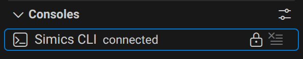

# Simics console

When the agent has the Simics `CommandLine` service, the Simics command line
opens in a terminal named **Simics CLI** after attaching. Simics does all
line editing, history and tab completion.

The console uses the debug session's connection. When the session ends, it
stays open, read-only and grayed out.

## The Consoles view

The **Consoles** view in the Run and Debug side bar lists the console of each
agent and its state. Click a console to show it, or to connect it when it is
not open or disconnected.

{width=298}

The button in the title of the view opens the
[settings](/configuration/settings). The buttons on a console are the lock
button, which switches the editing keys, and **Clear History**. They show
when the pointer is over the console, or when it is selected.

## Options

The options of the console are the `simics-target-debug.console.*`
[settings](/configuration/settings), under **Console**.

| Setting                                       | Default | Description                                                                                                  |
| --------------------------------------------- | ------- | ------------------------------------------------------------------------------------------------------------ |
| `simics-target-debug.console.open`            | `true`  | Open the console after attaching. When off, open it from the Consoles view.                                  |
| `simics-target-debug.console.historySessions` | `3`     | How many earlier sessions with the same agent to show above the command line. 0 turns it off.                |
| `simics-target-debug.console.editingKeys`     | `true`  | Send editing keys to Simics instead of VS Code while the console has focus.                                  |

When `open` is on, the Debug Console does not open at start.

## History of earlier sessions

The next session with the same agent shows the output of earlier sessions
above the command line, also after a window reload. `historySessions` sets
how many. **Clear History** in the Consoles view deletes them.

## Keys

- Ctrl+C copies the selection and stops the simulation. Ctrl+D is not sent.
- With `editingKeys` on, Ctrl+E, F, G, K, P, R and W (and Ctrl+\_ on Windows)
  go to Simics instead of VS Code while the console has focus. The lock
  button in the Consoles view switches the setting, in the workspace settings
  if they set it, else in the user settings.

## Stay in the console when the target stops

When the target stops, VS Code moves the focus to the editor. To keep the
focus in the console, so that Enter repeats for example `step-line`, turn off
the VS Code setting `debug.focusEditorOnBreak`.

## TCF trace

The console's TCF traffic and the Simics log events are left out of the
[TCF trace](/configuration/settings#tcf-trace) unless the silence list is
changed.
