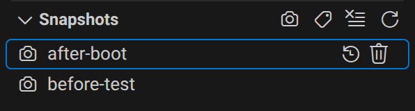

# Snapshots

The **Snapshots** view in the Run and Debug side bar lists the Simics
snapshots of the agent. Use it to take, restore and delete snapshots without
typing commands in the Simics CLI. Snapshots that are taken or deleted
elsewhere, for example in the Simics CLI, show up in the view too.

Snapshots need the Simics TCF agent with the snapshot commands of its
`SimUtils` service. With other agents, and with Simics versions that lack
these commands, the view says that snapshots are not available and the
buttons to take one are disabled.

{width=298}

The buttons in the title of the view are, from the left, **Take Snapshot**,
**Take Named Snapshot...**, **Delete All Snapshots...** and **Refresh
Snapshots**. The buttons on a snapshot are **Restore Snapshot** and **Delete
Snapshot**. They show when the pointer is over the snapshot, or when it is
selected.

## Take a snapshot

Use the buttons in the title of the view:

- **Take Snapshot** takes a snapshot with a free name, picked like the Simics
  command `take-snapshot` does: `snapshot`, `snapshot1`, `snapshot2` and so
  on.
- **Take Named Snapshot...** asks for the name, and suggests a free one. The
  name must not be used by another snapshot, and cannot start or end with
  white space.

## Restore and delete a snapshot

Each snapshot in the view has two buttons:

- **Restore Snapshot** restores the snapshot.
- **Delete Snapshot** deletes it, after asking.

**Delete All Snapshots...** in the title of the view deletes all snapshots of
the agent, after asking. This cannot be undone.

## From the Command Palette

The commands are also in the Command Palette, for example **Simics Target
Debug: Take Snapshot**. **Restore Snapshot** and **Delete Snapshot** then ask
which snapshot to use. **Refresh Snapshots** lists the snapshots again.
