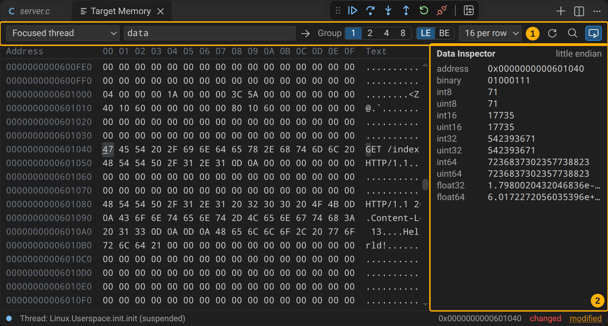

# Target Memory

The Target Memory view is a hex view of target memory. Unreadable bytes are
shown as `??`.

1. The toolbar. From the left: the memory to show, the address box, the
   number of bytes per group, the byte order and the number of bytes per row.
   The buttons on the right read memory again, open the find box, and show or
   hide the data inspector.
2. The data inspector.

The bar at the bottom shows which memory is shown, the address of the cursor,
and how changed and modified bytes are marked.

## Open the view

- **Simics Target Debug: Open Target Memory** in the Command Palette, also in
  the debug toolbar, opens the view.
- **Open in Target Memory** in the context menu of the Variables view shows
  what a pointer points to, or where any other variable is stored, with the
  variable's bytes selected.
- **New Target Memory View** in the editor title bar of the view opens
  another one.

## Select the memory

The view shows the memory of the focused thread, or of a physical memory
context (for example a Simics memory space) selected in the drop-down list.
Physical memory contexts have full names like the threads in the call stack,
for example `board.mb.phys_mem`.

## Go to an address

Enter an address (`0x1000`, or decimal) or an expression (`&buffer`, `$sp`)
evaluated in the selected frame, and press Enter to go there. Ctrl+G moves to
the address box. You can also scroll anywhere in the address space.

Ctrl+G and Ctrl+F are keybindings of the view
(`simics-target-debug.targetMemory.goto` and
`simics-target-debug.targetMemory.find`). They are active while the view is
the active editor, so they replace VS Code's Go to Line and Find there.

## When memory is read

Memory is read again automatically when the target stops, when another thread
gets the focus and when the agent reports that memory changed. Bytes that
changed are shown in red. The refresh button reads memory again on demand.

While the target runs, thread memory is dimmed and cannot be changed;
physical memory can still be read.

## Layout

Group 1, 2, 4 or 8 bytes. Groups are shown as numbers in little (default) or
big endian. The number of bytes per row is fixed or fits the width.

## Edit memory

Edit memory by typing hex digits over the groups, or text in the text column.

- Click a digit, or move with Left/Right, to put the caret on it; typing
  replaces just that digit.
- Up/Down keep the digit, Ctrl+Left/Right move by group and Shift+arrows
  select.
- Backspace moves back one digit and restores its original value.

Changed bytes are shown underlined until written: an Apply/Discard bar
appears. Enter applies the changes and Escape discards them.

## Find

Ctrl+F finds:

- Hex numbers, in the selected byte order, so `12345678` in little endian is
  the bytes `78 56 34 12`. Single bytes such as `de ad be ef` are a byte
  sequence.
- ASCII text.
- An 8 to 64-bit integer.

The search can be limited to aligned addresses, for example to find an 8-byte
integer only at multiples of 8, and to a range (by default the low 1 TiB).
Enter and Shift+Enter search forward and backward from the selection and wrap
around in the range. The buttons next to the range fields set it to start or
end at the cursor; a hint offers that when the cursor is outside the range.

The search shows its progress. Memory-mapped I/O is not read.

## Data inspector and copy

The data inspector shows the bytes at the cursor as integers and floating
point numbers. Right-click for the copy commands (hex, text or address); they
act on the right-clicked entry, or on the selection if it is in it.
