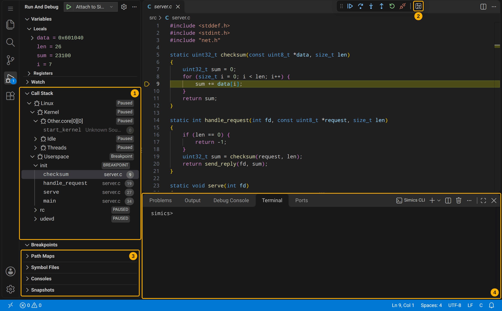

# Getting started

Simics Target Debug is a VS Code debugger extension that connects to a
[TCF](https://download.eclipse.org/tools/tcf/tcf-docs/) agent, for example
the Simics TCF agent. This page takes you from installing the extension to a
running debug session.

## Requirements

- VS Code 1.90 or later.
- A target with a TCF agent that VS Code can reach over TCP, for example a
  Simics session.
- Node.js 24 or later and npm, to build the extension.

## Install the extension

The extension is installed from a `.vsix` file that you build from the
[repository](https://github.com/intel/simics-vs-code-tcf-debug). Clone it,
then run these commands from its root directory:

```sh
npm ci
npm run package
```

This creates `simics-target-debug-<version>.vsix`. Install it in VS Code:

1. Press <kbd>Ctrl</kbd> + <kbd>Shift</kbd> + <kbd>P</kbd> to open the
   Command Palette.
2. Run **Extensions: Install from VSIX...**.
3. Select the generated `.vsix` file.

## Start the TCF agent

Start a TCF agent, for example in Simics:

```text
simics> new-tcf-agent
```

The agent listens on TCP port 1534 by default. Use
`new-tcf-agent parameters = "TCP::<port>"` to select another port.

## Attach to the agent

Start debugging with a launch configuration like this one in
`.vscode/launch.json`:

```json
{
  "type": "simics-target-debug",
  "request": "attach",
  "name": "Attach to TCF agent",
  "host": "localhost",
  "port": 1534
}
```

Without a `launch.json`, selecting the "Simics Target Debug" debugger
attaches to `localhost:1534`.

When the session has attached, the [Call Stack](/debugging/call-stack) view
shows the parts of the target that can run and be stopped. If the agent has
the Simics `CommandLine` service, the
[Simics console](/debugging/simics-console) opens in a terminal.

The debugger uses only standard TCF services. The Simics console and
[snapshots](/debugging/snapshots) need the Simics agent, and are not
available with other agents.

## Where to find things



1. The [Call Stack](/debugging/call-stack) view shows the processors,
   processes and threads of the target.
2. **Open Target Memory** in the debug toolbar opens the
   [Target Memory](/debugging/target-memory) view.
3. The extension adds four views to the Run and Debug side bar:
   [Path Maps](/configuration/path-mapping#the-path-maps-view),
   [Symbol Files](/configuration/symbol-files#add-symbol-files-while-debugging),
   [Consoles](/debugging/simics-console#the-consoles-view) and
   [Snapshots](/debugging/snapshots). Click a title to open the view.
4. The [Simics console](/debugging/simics-console) is a terminal in the
   panel.

## Next steps

- Source lines, line stepping and variables need symbol files. Load them
  with `add-symbol-file` in Simics, or from the debug configuration, see
  [Symbol files](/configuration/symbol-files).
- If the sources are not at the path compiled into the debug information,
  add [path mapping](/configuration/path-mapping) rules.
- [Launch configurations](/configuration/launch-configurations) lists the
  attributes of a debug configuration and describes the form to edit them.
- [Settings](/configuration/settings) lists the options that are the same
  for all debug sessions.
